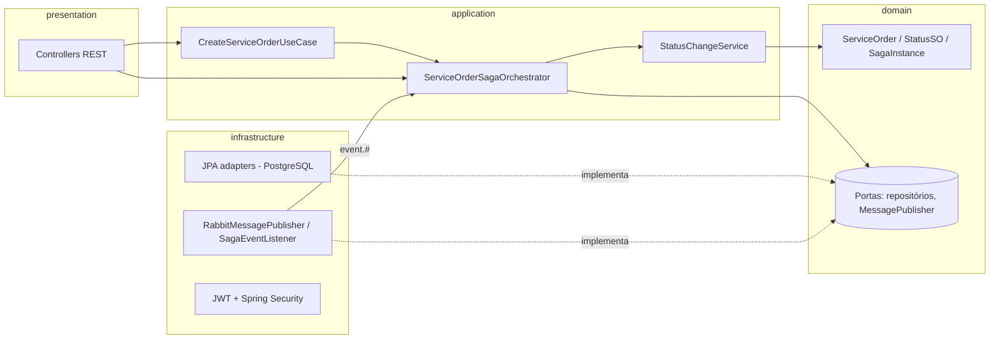
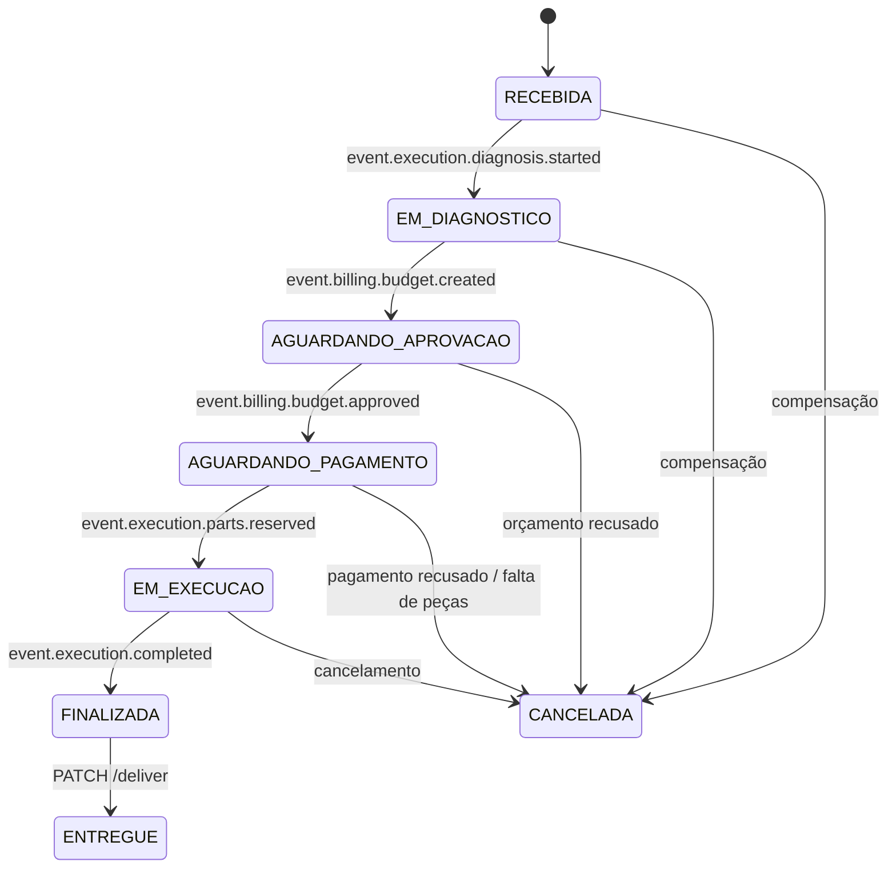

# OS Service — Ordem de Serviço e orquestrador da Saga

Microsserviço responsável pelo **ciclo de vida da Ordem de Serviço (OS)** da oficina e pela
**orquestração da Saga** que coordena os demais serviços (Billing e Execution).

| Item | Valor |
|---|---|
| Porta | `8081` |
| Banco | **PostgreSQL** (`os_db`) — relacional, dono de clientes, veículos, catálogo, OS, histórico e estado da Saga |
| Mensageria | RabbitMQ — publica *comandos* `command.*` e consome *eventos* `event.#` |
| Swagger | `http://localhost:8081/swagger-ui.html` |
| Health / métricas | `/actuator/health`, `/actuator/prometheus` |

## Responsabilidades
- Abertura da OS (valida cliente/veículo, precifica serviços e peças pelo catálogo).
- Atualização de status pela máquina de estados `StatusSO`.
- Consulta de status e **histórico** (`service_order_history`) — inclusive consulta pública pelo número da OS.
- **Orquestrador da Saga** (`ServiceOrderSagaOrchestrator`): envia comandos, reage aos eventos e executa as **compensações**.
- Emissão do **JWT** (login) usado pelos 3 serviços (segredo compartilhado `JWT_SECRET`).

## Arquitetura interna



Clean Architecture (mesma organização da Fase 1): domínio sem dependência de framework de mensageria; adaptadores na infraestrutura.
O `RabbitMessagePublisher` publica **somente após o commit** da transação local (evita comandos referentes a estado revertido)
e o consumo é **idempotente** (`processed_messages`).

## Máquina de estados da OS



## Mensagens

| Direção | Routing key | Quando |
|---|---|---|
| publica | `command.execution.diagnosis.start` | OS aberta |
| publica | `command.billing.budget.create` | diagnóstico concluído |
| publica | `command.execution.parts.reserve` | pagamento confirmado |
| publica (compensação) | `command.execution.cancel` | qualquer falha |
| publica (compensação) | `command.billing.budget.cancel` | falha antes do pagamento |
| publica (compensação) | `command.billing.payment.refund` | falha após o pagamento |
| consome | `event.#` (fila `os-service.events`, DLQ `os-service.events.dlq`) | respostas dos serviços |

## Endpoints principais
| Método | Rota | Descrição |
|---|---|---|
| POST | `/api/auth/login` | Login (JWT) |
| CRUD | `/api/customers`, `/api/vehicles` | Cadastros |
| CRUD | `/api/catalog/services`, `/api/catalog/parts` | Catálogo/preços |
| POST | `/api/service-orders` | **Abre a OS e inicia a Saga** |
| GET | `/api/service-orders[?status=]`, `/{id}` | Consulta |
| GET | `/api/service-orders/{id}/history` | Histórico de status |
| GET | `/api/service-orders/{id}/saga` | Estado da Saga (etapa, compensação, motivo) |
| POST | `/api/service-orders/{id}/cancel` | Cancelamento (dispara compensações) |
| PATCH | `/api/service-orders/{id}/deliver` | Entrega do veículo |
| GET | `/api/public/service-orders/{numero}` | Acompanhamento pelo cliente (sem login) |

## Como executar
```bash
cp .env.example .env   # preencha as senhas/segredos
./mvnw spring-boot:run # requer PostgreSQL e RabbitMQ (use o docker compose do repositório garage-infra)
```
Ambiente completo (3 serviços + bancos + RabbitMQ + observabilidade): veja o repositório **garage-infra**.

## Testes e qualidade
```bash
./mvnw verify   # testes unitários + BDD + JaCoCo (falha se cobertura de linhas < 80%)
```
- **BDD (Cucumber, Gherkin em português)**: `src/test/resources/features/fluxo_ordem_servico.feature`, com 5 cenários:
  caminho feliz completo, orçamento recusado, pagamento recusado, falta de peças com estorno e idempotência de mensagens.
  Relatório: `target/cucumber-report.html`.
- **Evidência de cobertura (JaCoCo, `./mvnw verify`)**: 88 testes, **99,4% de linhas**, 89,4% de branches, 98,0% de instruções.
  Relatório HTML em `target/site/jacoco/index.html` (publicado como artefato `jacoco-report` em cada execução do CI).
- **SonarCloud** no CI (Quality Gate obrigatório). Badge (substitua `SEU_PROJECT_KEY`):
  ``

## CI/CD
`.github/workflows/ci-cd.yml`: **build + testes (gate 80%)** → **SonarCloud** → **imagem no GHCR** → **deploy Kubernetes**
(cluster real via secret `KUBE_CONFIG` ou cluster *kind* efêmero no runner para validar manifestos + smoke test).
Manifestos em `k8s/` (Deployment com probes, Service, ConfigMap, HPA). Segredos vêm do Secret `garage-secrets`.
Proteção da branch `main`: veja `garage-infra/docs/branch-protection.md`.
